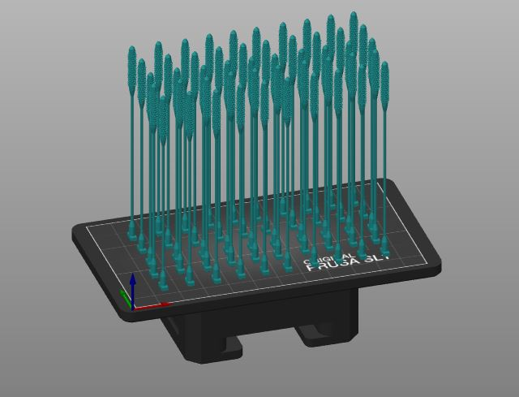

# Open source nasopharyngeal swab

A parametric nasopharyngeal swab for sampling COVID-19 and other respiratory
viruses, designed to be made locally on a resin (SLA) printer. The swab head is
printed in resin and cured under UV, then pressed into a handle printed on an
ordinary filament (FFF) printer.

It was developed in 2020, when swabs were short, and published in Gallup et al.
(2020), below. The paper reports mechanical and synthetic-mucus tests, and states
that the swabs need clinical verification before widespread use. This repository
does not change that: **the design has not been clinically validated.**



## What's here

| Path | What it is |
| --- | --- |
| `cad/nasal_swab.scad` | The OpenSCAD model: the swab (tip, breakable body and lock base) and the lock handle it fits into. |
| `cad/nasal_swab.json` | Customizer presets: `nasal_swab_bullet_tip`, `nasal_swab_cone_tip` and `lock_handle`. |
| `cad/nasal_swab_sl1.ini` | The PrusaSlicer settings the swab heads were sliced with. |
| `cad/tong_handle.stl` | The tong-style handle, an alternative to the lock handle. No source here. |
| `cad/durability_test_tube.stl` | A 10 × 10 × 42 mm test part. No source here. |

The UV curing box the paper describes is in its own repository,
[uwo-fast/uv-curing-box](https://github.com/uwo-fast/uv-curing-box).

## Making swabs

### Export the parts

Open `cad/nasal_swab.scad` in OpenSCAD and pick a preset in the Customizer, or
export from the command line:

```sh
openscad -p cad/nasal_swab.json -P nasal_swab_bullet_tip -o nasal_swab_bullet_tip.stl cad/nasal_swab.scad
openscad -p cad/nasal_swab.json -P lock_handle -o lock_handle.stl cad/nasal_swab.scad
```

The `render` parameter picks the part (`nasal_swab`, `lock_handle` or `both`) and
`tip_type` the tip (`bullet` or `cone`). The tip, body, base and handle sections of
the file set every dimension, each commented with its recommended value.

The model was tested with
[scadbatch](https://github.com/CameronBrooks11/scadbatch) for batch export.

### Check the model

`just check` renders every preset, and a slice of the swab around its breakpoint
hole, with warnings as errors, and compares their sizes and volumes with the
designed values (`tests/check_presets.py`). CI runs it on every pull request. It
checks the geometry only, not how a print performs.

### Print and cure

- **Swab heads:** resin. `cad/nasal_swab_sl1.ini` is for an Original
  Prusa SL1 with Prusa Orange Tough: 0.05 mm layers, 7.5 s exposure (35 s for the
  first layers), supports and pad on. Load it in PrusaSlicer with
  File > Import > Import Config.
- **Handles:** a filament printer.
- **Curing:** under UV, for example in the
  [UV curing box](https://github.com/uwo-fast/uv-curing-box). The paper tested
  tensile strength at four curing times.

### Cost

From the paper: $0.0603 a swab with the press-fit handle, $0.1138 with the
tong handle, and $45.42 for the UV curing system.

## Origin and licence

The swab model is by Adam Pringle of the Michigan Tech Open Sustainability
Technology (MOST) group, dated 2020-04-21 in the source; Cameron K. Brooks of the
FAST Research Group at Western reformatted it and replaced the deprecated
`assign()`. The design files were first published on the Open Science Framework,
<https://osf.io/z5jgu/>, and in
[ngallup4/Nasal-Swab-Files](https://github.com/ngallup4/Nasal-Swab-Files).

The paper releases the design under the GNU General Public License v3.0 and the
CERN Open Hardware Licence v1.2. This repository's [`LICENSE`](LICENSE) is the
GPL-3.0 text.

## Citation

If you use this design, please cite the paper (also in
[`CITATION.cff`](CITATION.cff)):

> Gallup, N., Pringle, A. M., Oberloier, S., Tanikella, N. G., & Pearce, J. M.
> (2020). Parametric nasopharyngeal swab for sampling COVID-19 and other respiratory
> viruses: Open source design, SLA 3-D printing and UV curing system.
> *HardwareX*, 8, e00135. <https://doi.org/10.1016/j.ohx.2020.e00135>

## Contributing

Issues and pull requests are welcome. See the organization
[contribution guide](https://github.com/uwo-fast/.github/blob/main/CONTRIBUTING.md).
